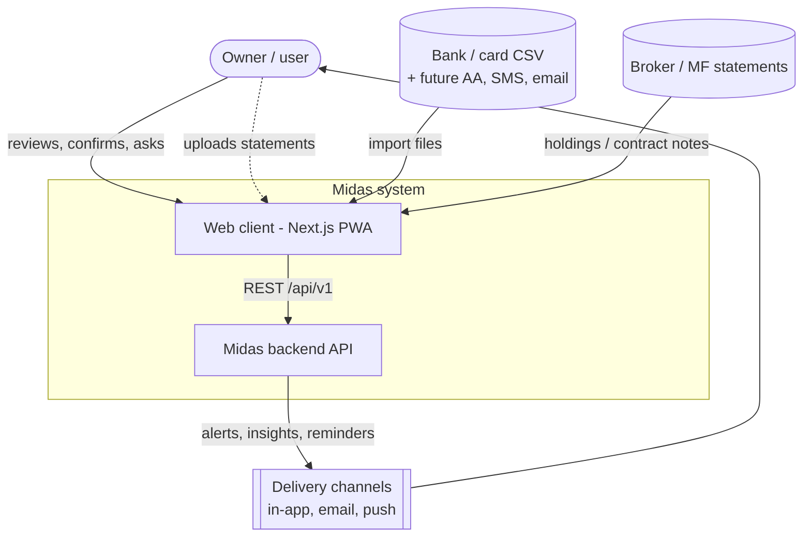
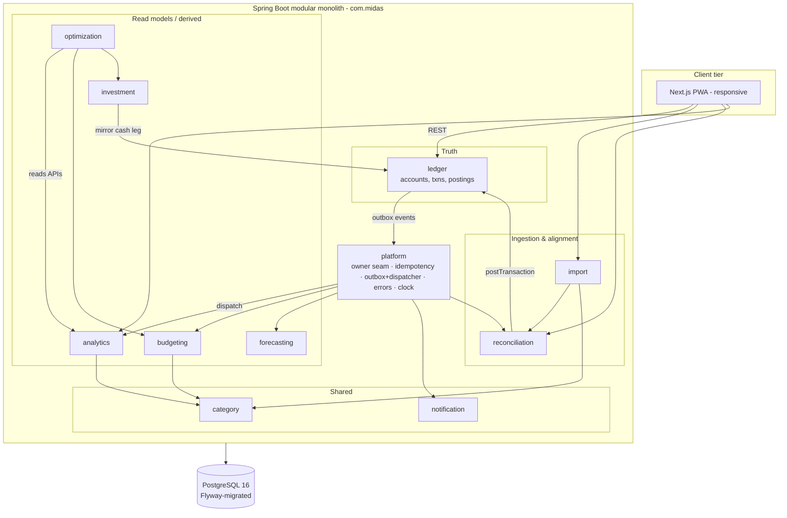
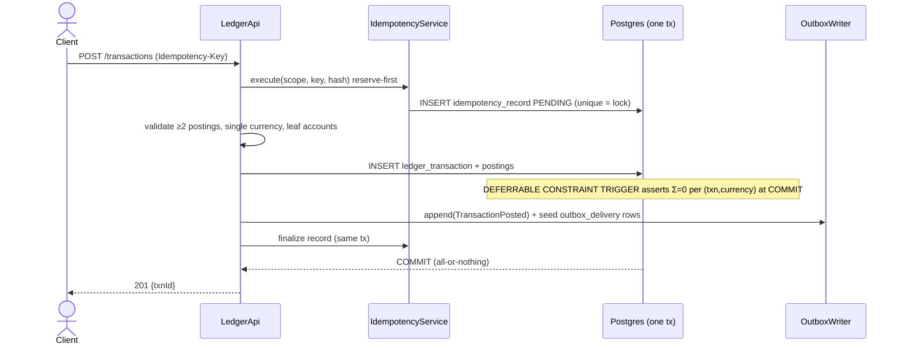
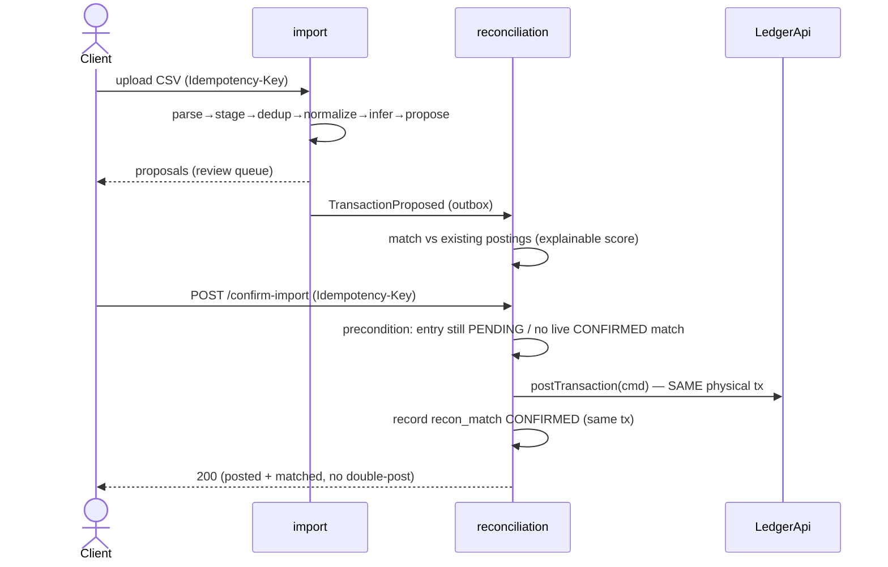
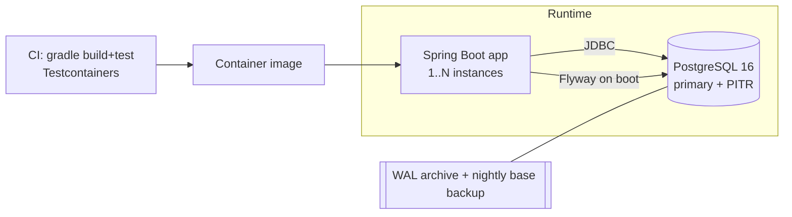

# Midas — High-Level Design (HLD)

**Date:** 2026-07-23
**Status:** For review (authored after requirements + detailed design + audit remediation)
**Sources:** `2026-07-19-midas-personal-treasury-os-design.md` (north star), `detailed/00–11`
(context designs), `2026-07-23-audit-and-opportunities.md` (audit).

This document consolidates the architecture that was previously scattered across the spec and
conventions, and fills the genuine HLD gaps: diagrams, concrete NFRs, security, deployment,
and Architecture Decision Records (ADRs). Per-context low-level design lives in `detailed/`;
per-phase LLD is authored just-in-time before each phase's build plan.

---

## 1. Purpose & architectural drivers

Midas is a personal financial **decision-support system** (not an expense tracker). The
architecture is shaped by four drivers, in priority order:

1. **Correctness of financial truth** — immutable, auditable, point-in-time-reconstructable
   double-entry. Everything else is derived and rebuildable.
2. **Temporal reasoning** — historical reconstruction, current state, and forward simulation.
3. **Derived intelligence over bookkeeping** — analytics, forecasting, optimization, and a
   future grounded AI copilot, all reading from truth, never inventing it.
4. **Evolvability** — single-user first, launchable to many later; monolith first,
   service-extractable later — both without rewrites.

**Quality attributes (ranked):** correctness/auditability > evolvability > security/privacy >
performance > availability. (A personal treasury tolerates seconds of projection lag; it does
not tolerate a wrong balance.)

---

## 2. System context (C4 L1)



**Boundaries:** Midas holds the user's entire financial history. External systems are *data
sources* (statements today; Account Aggregator / SMS / email / broker later) and *delivery
channels* (out). No external system is authoritative over Midas's ledger.

---

## 3. Container & component view (C4 L2/L3)

**Deployment shape:** a single Spring Boot application (modular monolith) over one PostgreSQL
database. Bounded contexts are internal modules with narrow public API interfaces; the outbox
is the async backbone between them.



**Dependency rules (enforced by architecture tests):**
- Only `ledger` owns financial truth. The **only** writers are `reconciliation` (confirming
  proposals) and `investment` (mirroring cash legs), both via `LedgerApi` **in the same
  physical DB transaction**. No other module writes ledger tables.
- Read-model contexts (`analytics`, `budgeting`, `forecasting`, `optimization`) **never**
  mutate truth; they consume outbox events and expose read APIs.
- Cross-context calls go through the public API interface only — never another context's
  tables/internals (conventions §15).
- `import` never writes truth; it produces staged entries + proposals (`TransactionProposed`).

**Context → phase → responsibility** is tabulated in `detailed/README.md`. Roadmap contexts
(`liabilities`, `goals`, `tax`, `copilot`) have reserved seams (conventions §12).

---

## 4. Data architecture

Three tiers, one database:

| Tier | Owner | Mutability | Consistency | Examples |
|---|---|---|---|---|
| **Truth** | `ledger` | append-only | strong | `ledger_transaction`, `posting`, `account` |
| **Staging** | `import` | mutable, re-derivable | n/a (pre-truth) | `import_statement_entry`, proposals |
| **Projections / derived** | analytics, budgeting, forecasting, optimization, reconciliation state | rebuildable from outbox | eventual | `analytics_*_month`, `budget_spend_rollup`, `recon_entry_state` |

- **The outbox is the backbone.** Every truth change writes a `TransactionPosted` /
  `TransactionReversed` event in the same tx (transactional outbox). Projections are folds
  over that durable event log and must be **replay-exact from genesis** (a tested property).
- **Point-in-time truth** = balance snapshots + postings in the gap, with snapshot
  invalidation on backdated/lagging inserts (see `02-ledger` Point-in-time).
- **Net worth** has one canonical definition (conventions §9): `Σ assets − Σ liabilities +
  Σ unrealized gain`, leaf accounts, investments at cost + gain once.
- **Single database now** with per-context schema ownership and prefixing; this is what lets a
  context later be extracted to its own service + DB by swapping the outbox backend to Kafka.

---

## 5. Key end-to-end flows

### 5.1 Post a transaction (idempotent, balanced, event-emitting)



### 5.2 Import → reconcile → confirm into ledger (the Phase-2 spine)



### 5.3 Outbox dispatch (per-consumer, ack-derived, DEAD-isolated)

```mermaid
sequenceDiagram
    participant S as OutboxDispatcher (@Scheduled)
    participant D as outbox_delivery
    participant C as EventConsumer (per consumer)
    participant P as processed_event
    loop each consumer
        S->>D: due PENDING by seq, FOR UPDATE SKIP LOCKED
        S->>C: handle(event) under event.owner_id scope
        alt success
            C-->>S: ok
            S->>P: INSERT (consumer,event_id)
            S->>D: mark SENT (same tx, ack-derived)
        else failure
            S->>D: attempts++, backoff; after N → DEAD (this consumer only)
        end
        S->>S: advance contiguous_seq over unbroken SENT prefix only
    end
```

### 5.4 Projection rebuild / catch-up
Drop a projection → replay `outbox` from genesis in `seq` order through the same consumer →
identical state (deterministic, signed folds). A `DEAD` delivery, once fixed, is reset to
`PENDING` and re-driven so the projection catches up.

---

## 6. Cross-cutting concerns

| Concern | Approach | Reference |
|---|---|---|
| Owner/tenant | `owner_id` on every aggregate; `OwnerContext` (fixed owner P0–5 → auth P6); async dispatch opens owner scope from `event.owner_id` | conventions §4 |
| Idempotency | Reserve-first record; same-tx finalize; cross-module single physical tx; per-leg sub-keys | §7 |
| Money | `BIGINT` minor units + currency; per-lot **total** cost; HALF_EVEN at boundaries | §2 |
| Time | UTC storage; **owner-local** (Asia/Kolkata) day/week/month + Apr–Mar FY bucketing | §3 |
| Corrections | Reversal = correction-time, derived state; refund = expense-credit txn; signed folds | §10 |
| Errors | RFC 9457 problem+json, stable per-context `code` | §11 |
| Events | Transactional outbox, per-`(event,consumer)` delivery, contiguous offset, dedup | §6 |

---

## 7. Non-functional requirements (concrete)

- **Consistency:** truth is strongly consistent (single-node ACID); projections are eventually
  consistent, target **< 2 s** propagation at normal load. Derived reads that require exactness
  (forecast t0 balances) read `LedgerApi`, never a projection.
- **Performance (single-user targets):** read APIs **p99 < 200 ms**; `postTransaction`
  **p99 < 150 ms**; `balanceAt` is O(postings since last snapshot) — snapshots keep it bounded.
- **Data volume:** design point ~10²–10⁵ transactions/owner over years; comfortably a single
  Postgres instance. No sharding needed at single-user or small-multi-user scale.
- **Availability:** target **99.9%** at launch; not a real-time/critical-path system — brief
  maintenance windows acceptable.
- **Durability:** **RPO ≤ 5 min** (Postgres WAL + PITR), **RTO ≤ 1 h**; nightly base backups +
  continuous WAL archiving; backup restores are tested.
- **Scalability path:** vertical first; per-context extraction via outbox→Kafka only if a
  context earns it. Dispatcher already uses `FOR UPDATE SKIP LOCKED` for multi-instance safety.
- **Observability:** structured JSON logs; metrics for **outbox lag (contiguous_seq vs max
  seq), DEAD-delivery count, dispatch latency, projection rebuild time, API latency/error
  rate**; health endpoint; a DEAD-delivery alert is itself delivered via notification.

---

## 8. Security & privacy architecture

Today auth/encryption are stubs — this is the deliberate design to build toward (the audit
flagged both as launch-blockers; full build is Phase 6, but the architecture is decided now).

- **Authentication:** none in P0–5 (single trusted owner). Phase 6: OIDC or password + **MFA**,
  server-side sessions, rate-limiting on auth + write endpoints. The `OwnerContext` seam means
  turning this on requires **no schema change**.
- **Authorization:** every repository query is owner-scoped via the base repository; the async
  dispatch path runs under `event.owner_id`. Cross-owner leakage is structurally prevented.
- **Encryption at rest:** DB-level encryption baseline; **raw statements (`import_raw_file`)
  and account/counterparty identifiers treated as sensitive** — app-level envelope encryption
  with a KMS-managed key. **Data minimization:** decide raw-file retention (purge after
  successful parse vs keep) — leaning purge-after-parse.
- **Transport:** TLS everywhere; secrets from a secret manager / env, never literals.
- **Privacy / DPDP (India):** export/portability (full ledger + statements), **deletion /
  right-to-erasure**, and a user-facing access/audit log. Deletion tensions with the
  append-only ledger → resolved by **crypto-shredding** (destroy the owner's encryption keys)
  rather than mutating immutable rows (see ADR-011 candidate; to be firmed in the security
  phase).
- **AI copilot (roadmap):** grounded strictly in context-API tool outputs; no raw data to the
  model; every numeric claim must trace to a tool call or be suppressed.

---

## 9. Deployment & runtime view



- **Build/CI:** Gradle (Java 21), Testcontainers-backed tests on every PR; image published on
  merge.
- **Config:** env-based (`DB_URL`, secrets from manager); `Clock` injected.
- **Migrations:** Flyway on boot, forward-only, one versioned file per change.
- **Environments:** local (Docker Postgres) → staging → prod; single region at launch.
- **Multi-instance:** the dispatcher is safe under `SKIP LOCKED`; the app is otherwise
  stateless (owner context per request/event).

---

## 10. Evolution roadmap (architectural)

- **Outbox → Kafka:** swap the dispatcher backend with no producer/consumer change when async
  fan-out or cross-service delivery is needed.
- **Monolith → services:** extract a read-model context (e.g. `analytics`) to its own service +
  DB, fed by the same events; truth stays central. Do this only when a context earns it.
- **Single-owner → multi-user:** flip `OwnerContext` to the auth principal (no schema change);
  add auth/session/MFA + the security build-out (§8).
- **Roadmap contexts** land in their own phases against reserved seams: `liabilities`
  (amortization + account rate metadata), `goals`, `tax` (cap-gains/80C/advance-tax),
  `copilot`.

---

## 11. Architecture Decision Records

Concise ADRs for the decisions already made — context, decision, alternatives rejected,
consequences.

**ADR-001 — Ledger-first double-entry as the source of truth.**
*Decision:* immutable double-entry postings (sum-zero), balances derived, corrections by
reversal. *Rejected:* mutable balances (unauditable, no point-in-time); full event-sourcing of
everything (YAGNI, heavy). *Consequence:* every number is reconstructable; reads need snapshots
for speed.

**ADR-002 — Modular monolith, not microservices.**
*Decision:* one app, one DB, contexts as modules behind interfaces. *Rejected:* microservices
(distributed complexity unjustified single-user). *Consequence:* simple ops now; outbox seam
preserves later extraction.

**ADR-003 — Transactional outbox with per-consumer delivery.**
*Decision:* co-commit events with state; per-`(event,consumer)` delivery + contiguous offset.
*Rejected:* dual-write (lost events); one status per event (poison consumer starves others);
full CQRS/ES (overkill). *Consequence:* at-least-once + idempotent consumers; durable log = the
rebuild source, so it is never pruned.

**ADR-004 — Net worth = cost + Σ unrealized gain.**
*Decision:* ledger holds investment cost; analytics adds unrealized gain once. *Rejected:*
exclude broker accounts + add market value (two-sided sync, easy to double-count).
*Consequence:* one canonical formula; illiquid assets reuse the same mark seam.

**ADR-005 — Owner/tenant seam, single-owner first.**
*Decision:* `owner_id` everywhere from day one; auth deferred. *Rejected:* multi-tenant infra
now (premature); retrofitting tenancy later (expensive, error-prone). *Consequence:* multi-user
is a `OwnerContext` flip, no schema change.

**ADR-006 — Category as a dedicated shared context.**
*Decision:* one `category/` taxonomy + resolver consumed by all. *Rejected:* per-context
category (the 4-way divergence the audit found); analytics-owned kernel (couples everyone to a
read model). *Consequence:* one owned dimension; `CategoryReassigned` re-homes history.

**ADR-007 — Reserve seams for loans / illiquid / obligations; full build later.**
*Decision:* add hooks now (account rate metadata, `manual_valuation`, obligation registry
interface), design full contexts in their phases. *Rejected:* full model now (expands scope);
defer entirely (bakes in wrong assumptions the audit flagged). *Consequence:* no ugly retrofit;
detectors/forecasts have real sources.

**ADR-008 — Money as BIGINT minor units; per-lot total cost.**
*Decision:* integer paise + currency; store aggregate cost as a total, derive per-unit.
*Rejected:* decimal/float (rounding drift); per-unit cost stored (leaks basis on fractional
units — an audit CRITICAL). *Consequence:* exact reconciliation with the ledger.

**ADR-009 — Owner-local time + Apr–Mar Financial Year.**
*Decision:* store UTC, bucket periods in owner-local (Asia/Kolkata); FY is first-class.
*Rejected:* UTC buckets (misattributes IST month-edge txns; double-imports). *Consequence:* tax
features and monthly numbers are correct for the Indian user.

**ADR-010 — API-first; UI at Phase 3; single responsive PWA.**
*Decision:* build/harden the API first, first real UI at Phase 3, one responsive Next.js PWA.
*Rejected:* UI-first (nothing to show over an empty ledger); separate native app now (two
codebases premature). *Consequence:* read APIs must be validated against low-fi screens before
Phase 3 hardens them (UX foundation pass).

---

## 12. Risks & open items

- **Security build-out (auth/MFA, encryption-at-rest, export/deletion/backup)** — architected
  here, not yet built; launch-blocking (audit Part B). Needs its own phase before Phase 6.
- **Deletion vs append-only** — crypto-shredding approach to be confirmed (candidate ADR-011).
- **UX read-model coupling** — Phase 3 read APIs should be shaped against screens; do the UX
  foundation pass first (journeys + low-fi wireframes).
- **Roadmap depth** — loans/tax/goals/copilot and AA ingestion are Tier 2/3 (audit); sequenced
  but not yet designed.

---

## 13. Traceability

- Requirements → `2026-07-19-...-design.md` (north star) + PRD.
- Per-context LLD → `detailed/00–11` (amended 2026-07-23).
- Audit findings & remediation → `2026-07-23-audit-and-opportunities.md`.
- Build → per-phase plans in `docs/superpowers/plans/` (Phase 0 done; Phase 1 next, authored
  as LLD → plan).
